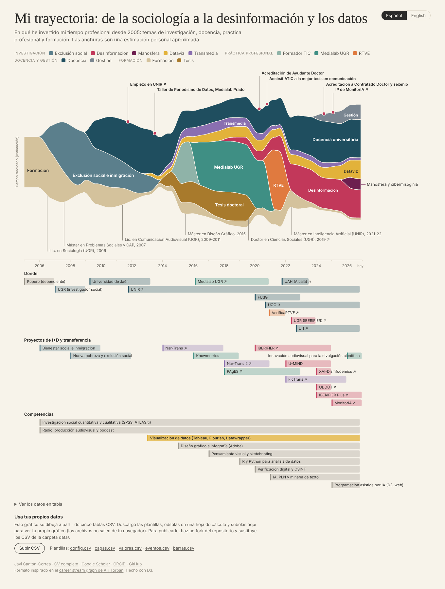

# Mi trayectoria (stream graph)

Stream graph de la trayectoria de Javi Cantón-Correa, inspirado en el de Alli Torban. D3 v7, sin build.

Visible en: https://javicanton.github.io/steamgraph-cv/



## Haz el tuyo

Todos los datos están en cinco tablas CSV dentro de `data/`. El código no hay que tocarlo.

1. **Probar sin instalar nada:** en la página, sección *Usa tus propios datos*, descarga las plantillas, edítalas en una hoja de cálculo y súbelas. Puedes subir solo las que cambies; el resto se toma del gráfico actual. Los archivos no salen de tu navegador.
2. **Publicarlo:** haz un *fork* de este repositorio, sustituye los CSV de `data/` y activa GitHub Pages (*Settings > Pages*, rama `main`, carpeta raíz).
3. **Cargar CSV de otra dirección:** `index.html?datos=https://…/carpeta/` lee los cinco archivos de esa carpeta (el servidor debe permitir CORS, como `raw.githubusercontent.com`).

Para verlo en local, sírvelo con un servidor (`python3 -m http.server`); abriendo el archivo directamente el navegador bloquea la lectura de los CSV.

Se aceptan CSV separados por comas o por punto y coma (como los que exporta Excel en español) y decimales con punto o con coma. Las columnas `_en` son opcionales: si están vacías se usa el español, y si no hay ninguna rellena desaparece el selector de idioma.

## Las cinco tablas

### `capas.csv`: las franjas del gráfico

Una fila por franja. **El orden de las filas es el orden de abajo arriba.**

| Columna | Qué es |
|---|---|
| `id` | Identificador corto, sin espacios. Debe coincidir con una columna de `valores.csv`. |
| `grupo` | Grupo de la leyenda (por ejemplo `investigacion`). Su nombre visible va en `config.csv`. |
| `color` | Color en hexadecimal (`#c2385a`). Si se deja vacío, se asigna uno. |
| `desde`, `hasta` | Años de inicio y fin (admiten decimales: `2020.9` es finales de 2020). `hasta` vacío = sigue activa hoy. |
| `nombre_es`, `nombre_en` | Nombre completo (etiqueta dentro de la franja y tooltip). |
| `corto_es`, `corto_en` | Nombre corto (leyenda, y etiqueta si la franja es estrecha). Opcional. |
| `desc_es`, `desc_en` | Descripción del tooltip. Opcional. |
| `proyectos` | Proyectos relacionados, como texto libre (sale en el tooltip). Opcional. |

### `valores.csv`: cuánto tiempo dedicas a cada franja

Una fila por año y una columna por `id` de capa. El valor es un peso aproximado de 0 a 10 (10 = jornada completa). **Las celdas vacías no cuentan**: entre dos años con valor se interpola, así que basta con rellenar los años en que algo cambia. Fuera de `desde`/`hasta` la franja vale 0.

```
año,formacion,docencia,desinfo
2006,6,,
2009,2.5,3,
2018,,2.2,0.4
```

### `eventos.csv`: anotaciones

| Columna | Qué es |
|---|---|
| `tipo` | `hito` (punto sobre el gráfico) o `titulo` (línea hacia abajo, para títulos y formación). |
| `año` | Posición en el eje (admite decimales). |
| `texto_es`, `texto_en` | Texto de la anotación. |
| `url` | Enlace opcional (añade ↗). |
| `capa` | Opcional, solo para `titulo`: la línea sale del borde inferior de esa capa en vez del borde del gráfico. |

### `barras.csv`: filas de barras bajo el eje

Una fila por barra. La columna `seccion` agrupa las barras en bloques (aquí `centros`, `proyectos` y `competencias`), en el orden en que aparecen.

| Columna | Qué es |
|---|---|
| `seccion` | Bloque al que pertenece. Su título va en `config.csv`. |
| `nombre_es`, `nombre_en` | Texto de la barra. |
| `desde`, `hasta` | Años. `hasta` vacío = hasta hoy; `hasta` es exclusivo (un proyecto 2014-2017 va de 2014 a 2018). |
| `capa` | Opcional: toma el color de esa capa. Vacío = gris. |
| `url` | Enlace opcional. |
| `destacada` | `sí` para resaltarla. |

### `config.csv`: textos generales

Columnas `clave`, `es`, `en`.

| Clave | Qué es |
|---|---|
| `titulo`, `subtitulo` | Cabecera de la página. |
| `eje_y` | Rótulo del eje vertical. |
| `pie` | Pie de página. Admite enlaces `<a href="…">` y saltos `<br>`. |
| `grupo.<id>` | Nombre visible de cada grupo de la leyenda. El orden de estas filas es el orden de la leyenda. |
| `seccion.<id>` | Título de cada bloque de barras. |
| `inicio`, `fin`, `hoy` | Opcionales (año en la columna `es`). Por defecto el eje empieza en el primer año con datos y termina en la fecha actual. |

## Incrustar el gráfico

`?embed=1` muestra solo el stream graph, sin cabecera, leyenda ni barras. Para la versión inglesa, añade `&lang=en`.

```html
<iframe src="https://javicanton.github.io/steamgraph-cv/?embed=1"
        width="100%" height="520" style="border:0" loading="lazy"
        title="Mi trayectoria (stream graph)"></iframe>
```
